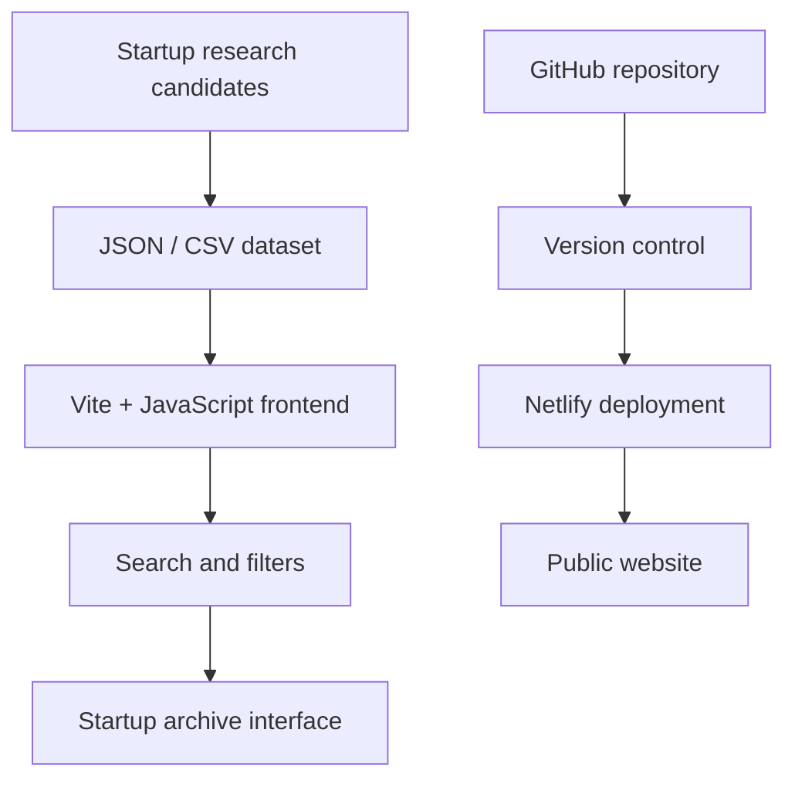

<div align="center">
  
</div>
<p align="center">
  
</p>

<p align="center">
  
</p>

<h1 align="center">⚰️ THE GRAVEYARD</h1>
<h3 align="center">Global Startup Failure Intelligence Atlas</h3>
<p align="center">
  <a href="https://dancing-gumption-3b93b4.netlify.app"><strong>🌐 Explore the Live Website</strong></a> ·
  <a href="https://github.com/Phk006/Startup-graveyard"><strong>💻 Source Code</strong></a>
</p>

<p align="center">
  
  
  
</p>

---

## 🌍 What is The Graveyard?

**The Graveyard** is a research-led platform that aims to make startup failure history easier to explore, understand and learn from.

Startup stories are usually celebrated at launch and funding milestones. But when a venture shuts down, restructures, enters insolvency, or discontinues a product, the lessons are scattered across news reports, company announcements, court records and founder reflections.

The Graveyard brings these stories into one organised experience — searchable by company, geography, industry and year — while preserving the context and evidence behind each record.

> **The idea is not to celebrate failure. It is to make the lessons of failure accessible.**

### 🔗 Live project
**[dancing-gumption-3b93b4.netlify.app](https://dancing-gumption-3b93b4.netlify.app)**

---

## ✨ What the project is designed to do

- **Explore a global archive:** discover startups across countries, cities and industries.
- **Understand what happened:** distinguish a shutdown from bankruptcy, liquidation, acquisition, restructuring or product discontinuation.
- **Study failure patterns:** explore recurring themes such as weak unit economics, funding dependency, market timing, operational complexity and product-market fit.
- **Learn from company journeys:** connect the founding story, growth phase, major events and eventual outcome.
- **Keep evidence visible:** attach sources and confidence levels to claims instead of presenting unverified stories as facts.
- **Support better decisions:** help students, founders, researchers and ecosystem builders learn from previous attempts.

The long-term product direction is an interactive, Google-Maps-style geographical atlas with zoomable locations, map pins, filters, company profiles and a chronological failure timeline.

---

## 🧰 Technology used in the current project

This section separates what is present in the current starter from what is part of the proposed next-stage architecture.

| Technology / Tool | How it is used |
|---|---|
| **HTML5** | Provides the page structure and semantic content. |
| **CSS3** | Handles the dark visual theme, responsive layout, typography, cards and styling. |
| **JavaScript (ES modules)** | Powers archive rendering, search, filtering and dynamic UI updates. |
| **Vite** | Provides the frontend development server and production build pipeline. |
| **JSON** | Stores structured startup research records for the frontend. |
| **CSV** | Provides a portable dataset format for review, analysis and spreadsheet workflows. |
| **Animated GIF** | Adds the animated globe visual to the project introduction and README. |
| **Git & GitHub** | Version control, source-code hosting and project collaboration. |
| **Netlify** | Hosts the public live website. |

### Current implementation flow



### Proposed architecture for the full atlas

The following are **planned technologies**, not claims that every component is already implemented:

| Planned technology | Intended responsibility |
|---|---|
| **Next.js + TypeScript** | Scalable application structure, typed data models and server-side functionality. |
| **Google Maps Platform or MapLibre** | Interactive global map, zoom levels, location markers and map navigation. |
| **Supabase / PostgreSQL + PostGIS** | Persistent startup records and efficient geographic queries. |
| **Geocoding service** | Convert verified historical addresses into coordinates. |
| **Scheduled ingestion jobs** | Periodically discover updates and flag records for review. |
| **Admin review dashboard** | Verify sources, resolve duplicates, correct locations and approve changes. |

---

## 🧭 How the data should work

A failure archive must be more careful than a list of companies that disappeared.

### Different outcomes must stay different

| Classification | Meaning |
|---|---|
| Bankruptcy / insolvency | Formal legal process, supported by reliable legal or regulatory evidence. |
| Liquidation | Winding up a company and distributing its assets under the relevant process. |
| Administration | A jurisdiction-specific formal process; not interchangeable with every shutdown. |
| Shutdown | Operations ceased, but formal bankruptcy has not been established. |
| Product discontinued | A product ended while its parent company may continue operating. |
| Acquisition / restructuring | Ownership or operations changed; not automatically a company failure. |

### Location accuracy

The map should distinguish a documented historical office address from a city-level approximation. A city-centre coordinate must never be presented as the exact location of a startup's former office.

Each location should eventually include:
- Location type: founding location, operating office, historical HQ or registered address.
- Latitude and longitude, only when supported by evidence.
- Precision level: address, campus, city or region.
- Source URL and verification status.

### Dataset status

The starter dataset contains **39 candidate records**. They are research leads, not a verified global failure database. Dates, explanations and classifications need company-level source checks. Coordinate fields are deliberately empty rather than fabricated.

---

## 🤝 How can The Graveyard be useful to society?

### 1. For students and aspiring entrepreneurs
Students can learn that building a company involves much more than a good idea. They can study pricing, distribution, customer retention, operations, cash flow and timing through real-world examples.

### 2. For founders and startup teams
Founders can identify recurring warning signs before they become existential problems — for example, unsustainable acquisition costs, weak retention, excessive burn or dependence on a single funding source.

### 3. For educators and institutions
Faculty members, entrepreneurship cells and incubators can use documented company journeys as case studies for classroom discussions, startup workshops and business-model analysis.

### 4. For researchers and policy thinkers
A structured, source-linked archive can help researchers examine patterns across sectors, regions and time periods. With sufficient verified data, it may support analysis of why certain business models struggle in particular markets.

### 5. For investors and ecosystem builders
Investors, mentors and incubators can use the archive as a learning resource to ask better diligence questions and understand risks that may be overlooked during periods of rapid growth.

### 6. For society at large
It can help replace the stigma around failure with a more informed conversation: honest accountability, evidence, learning and the possibility of trying again.

**The social value:** preserving lessons that might otherwise disappear when a startup shuts down.

---

## 🗂️ Repository structure

```text
startup-graveyard/
├── data/
│   ├── startups.json
│   └── startups.csv
├── docs/
│   ├── CONTRIBUTING.md
│   └── DATA_METHODOLOGY.md
├── public/
│   └── assets/
│       └── graveyard-globe.gif
├── src/
│   ├── main.js
│   └── style.css
├── index.html
├── package.json
├── .gitignore
├── LICENSE
└── README.md
```

---

## 🚀 Run locally

**Requirements:** Node.js and npm.

```bash
git clone https://github.com/Phk006/Startup-graveyard.git
cd Startup-graveyard
npm install
npm run dev
```

Create a production build:

```bash
npm run build
npm run preview
```

### Netlify deployment settings

- **Build command:** `npm run build`
- **Publish directory:** `dist`

Connect the GitHub repository to Netlify to enable deployments when changes are pushed to the configured branch.

---

## 🧪 Roadmap

- [x] Initial responsive frontend starter
- [x] Searchable and filterable candidate archive
- [x] JSON and CSV data formats
- [x] Animated project introduction asset
- [x] Research methodology and contribution notes
- [ ] Source verification for every startup record
- [ ] Historical address research and coordinate validation
- [ ] Interactive global map and marker clustering
- [ ] Detailed startup profiles and failure timelines
- [ ] Geographic and industry-level analytics
- [ ] Admin review and duplicate-resolution workflow
- [ ] Scheduled, source-attributed update pipeline

---

## 📚 Research principles

1. Prefer company statements, court records, regulator filings and reputable reporting.
2. Cite the source for the failure event and, separately where possible, the stated cause.
3. Preserve publication dates and access dates.
4. Never infer bankruptcy from a product closure or acquisition.
5. Never invent dates, funding amounts, founders or coordinates.
6. Clearly label uncertainty and allow corrections.

See [Data Methodology](docs/DATA_METHODOLOGY.md) and [Contributing](docs/CONTRIBUTING.md).

## ⚖️ Disclaimer

The Graveyard is an educational research project. It is not legal, financial or investment advice. Company status can change, and historical reporting may be incomplete. Records should be independently verified before being relied upon.

---

<p align="center">
  <strong>THE GRAVEYARD</strong><br/>
  <em>Every ending leaves a lesson. Make sure we don't lose it.</em>
</p>
