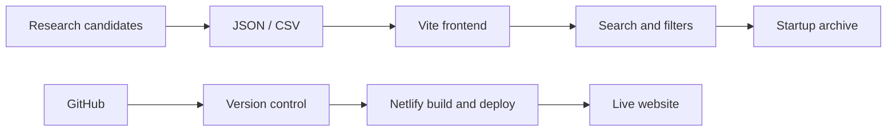

<div align="center">

<!-- EARTH VIDEO GIF — keep this as the first visible element in the README -->


<br />

</div>

---

## 🌍 The idea

**The Graveyard** is a research-led platform built around one question:

> What can we learn from the startups that didn't make it?

The startup ecosystem documents launches, funding rounds and success stories in detail. The stories of businesses that close, restructure, enter insolvency or discontinue products are often scattered across news articles, company announcements and public records.

The Graveyard aims to bring those stories together in one searchable, geographically explorable archive — with evidence and context attached to each record.

**This is not a platform that celebrates failure. It is a platform that preserves the lessons.**

## ✨ What users will be able to explore

- **Global startup archive** — browse companies by country, city, industry and year.
- **Failure journeys** — understand the events leading to a shutdown or other outcome.
- **Company profiles** — explore founders, business model, product, funding history and timeline when reliable information is available.
- **Failure patterns** — examine recurring challenges such as weak unit economics, poor retention, market timing and operational complexity.
- **Evidence and sources** — trace important claims back to source material and see when information is uncertain.
- **Geographic discovery** — the planned map interface will let users zoom from the world to countries, cities and documented company locations.

## 🧰 Technology and tools

### Current starter implementation

| Technology | Role in the project |
|---|---|
| **HTML5** | Semantic structure and page content |
| **CSS3** | Dark visual identity, responsive layout and component styling |
| **JavaScript (ES modules)** | Dynamic archive rendering, search and filtering |
| **Vite** | Local development server and production build |
| **JSON** | Structured startup candidate records consumed by the frontend |
| **CSV** | Portable dataset for spreadsheet review and analysis |
| **Git + GitHub** | Version control, source hosting and collaboration |
| **Netlify** | Hosting for the public website |
| **GIF** | Looping Earth visual used as the README hero animation |

### Planned architecture

The following components describe the intended next stage; they should not be mistaken for features already shipped.

| Technology | Planned use |
|---|---|
| **Next.js + TypeScript** | Scalable application architecture and typed data models |
| **Google Maps Platform / MapLibre** | Interactive map, geographic navigation and startup markers |
| **Supabase + PostgreSQL** | Persistent application database and APIs |
| **PostGIS** | Geographic indexing and location-based queries |
| **Geocoding service** | Convert verified historical addresses into coordinates |
| **Scheduled jobs** | Periodic source checks and dataset refresh workflows |
| **Admin review interface** | Source verification, duplicate resolution and record corrections |

### Current data flow



## 🤝 Why this can matter to society

### 🎓 Students and aspiring entrepreneurs
Learn practical lessons beyond textbook success stories: pricing, customer discovery, cash flow, distribution, retention and business-model validation.

### 🚀 Founders and startup teams
Use documented cases to recognise risk signals earlier — including unsustainable acquisition costs, over-expansion, funding dependency and weak product-market fit.

### 🏫 Universities, incubators and entrepreneurship cells
Turn real company histories into classroom case studies, workshops and discussions about responsible entrepreneurship.

### 🔬 Researchers and policy thinkers
A well-sourced dataset can help study patterns across sectors, geographies and time periods. This may support more evidence-based discussions about startup ecosystems.

### 💼 Investors, mentors and ecosystem builders
Use historical cases as a learning resource for better diligence questions and a deeper understanding of operational risks.

### 🌱 Society
Encourage a healthier view of entrepreneurial failure: not shame or blind glorification, but honest accountability, learning and informed second attempts.

**The intended social impact is simple: preserve knowledge that might otherwise disappear when a company closes.**

## 🧭 Data integrity comes first

A company shutting down is not automatically the same as bankruptcy. The archive must distinguish:

| Outcome | Meaning |
|---|---|
| **Bankruptcy / insolvency** | A formal legal process supported by authoritative evidence |
| **Liquidation** | A process to wind up a company and realise/distribute assets |
| **Administration** | A jurisdiction-specific formal process |
| **Shutdown** | Operations ceased; formal insolvency may not be established |
| **Product discontinued** | A product ended while its parent company may continue |
| **Acquisition / restructuring** | Ownership or operations changed; not automatically a failure |

### Location accuracy

The map must not turn an approximate city location into a supposedly exact historical office address. Founding location, operating location, historical headquarters and registered address should be stored separately when known.

Coordinates should be added only when supported by a documented historical address. Unknown coordinates should remain empty and carry an explicit confidence/precision label.

### Dataset status

The initial dataset contains **39 research candidates**. These are starting points for investigation, not a fully verified global failure register. Dates, reasons and legal classifications must be checked against company statements, court or regulator records, and reliable reporting before being treated as confirmed.

## 🗂️ Repository structure

```text
startup-graveyard/
├── data/
│   ├── startups.json
│   └── startups.csv
├── docs/
│   ├── CONTRIBUTING.md
│   └── DATA_METHODOLOGY.md
├── public/
│   └── assets/
│       └── graveyard-globe.gif
├── src/
│   ├── main.js
│   └── style.css
├── index.html
├── package.json
├── .gitignore
└── LICENSE
```

## 🚀 Run locally

**Requirements:** Node.js and npm.

```bash
git clone https://github.com/Phk006/Startup-graveyard.git
cd Startup-graveyard
npm install
npm run dev
```

Create and preview a production build:

```bash
npm run build
npm run preview
```

### Netlify deployment

- **Build command:** `npm run build`
- **Publish directory:** `dist`

Connect the GitHub repository to Netlify to enable deployment from your chosen branch.

## 🛣️ Roadmap

- [x] Responsive frontend starter
- [x] Searchable and filterable candidate archive
- [x] JSON and CSV data formats
- [x] Project README visual identity
- [x] Research methodology and contribution guidance
- [ ] Verify every company record against reliable sources
- [ ] Research historical addresses and validate coordinates
- [ ] Build interactive world map and marker clustering
- [ ] Add company profiles and chronological failure timelines
- [ ] Add industry, geography and year analytics
- [ ] Build admin verification and duplicate-review tools
- [ ] Add source-attributed scheduled data updates

## 📚 Research principles

1. Prefer company statements, court records, regulator filings and reputable reporting.
2. Cite the source for the failure event and, where possible, a separate source for the stated cause.
3. Preserve publication dates and access dates.
4. Never infer bankruptcy from a product closure or acquisition.
5. Never invent dates, founders, funding amounts or coordinates.
6. Clearly label uncertainty and support corrections.

Read the [Data Methodology](docs/DATA_METHODOLOGY.md) and [Contributing Guide](docs/CONTRIBUTING.md) before adding records.

## ⚖️ Disclaimer

The Graveyard is an educational research project, not legal, financial or investment advice. Company status can change, and historical reporting may be incomplete. Independently verify records before relying on them.

<div align="center">

---

**THE GRAVEYARD**

*Every ending leaves a lesson. Make sure we don't lose it.*

[Explore the live project →](https://dancing-gumption-3b93b4.netlify.app)

</div>
